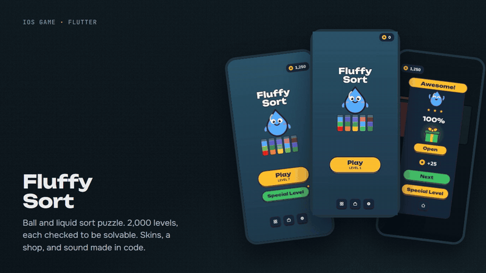
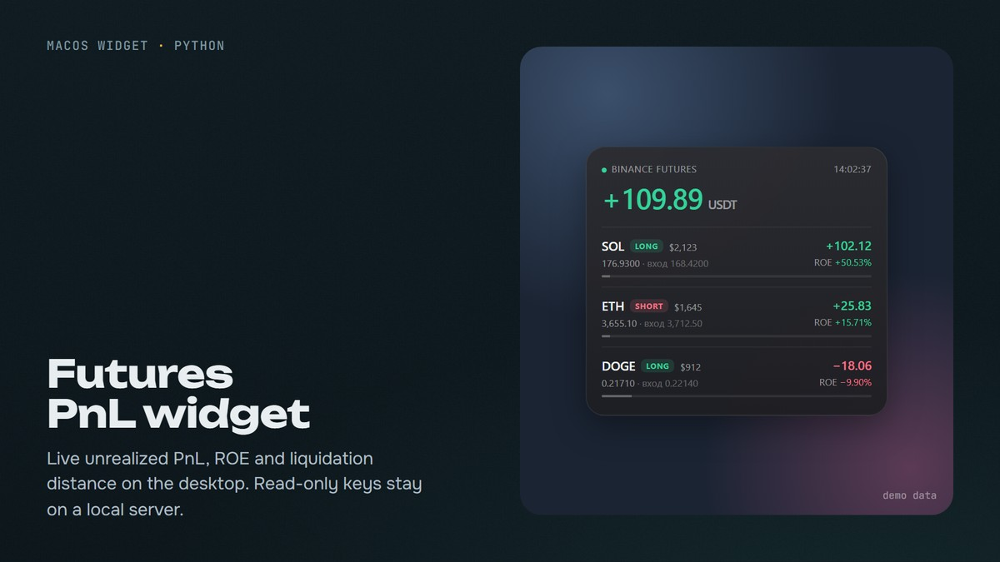
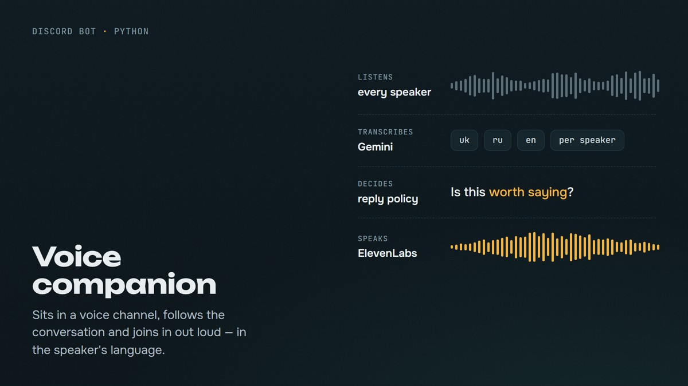

I build things that listen, watch and count: voice bots, AI video pipelines, small trading tools, and a puzzle game for iPhone. More at [hysk.pro](https://hysk.pro).

<table>
  <tr>
    <td width="50%" valign="top">
      
       <b><a href="https://hysk.pro/fsp">Fluffy Sort</a></b> · Flutter
       Ball and liquid sort puzzle for iPhone. 2,000 levels, each checked by a built-in solver.
    </td>
    <td width="50%" valign="top">
      
       <b><a href="https://github.com/heavy-shark/widget_binance">widget_binance</a></b> · Python, Übersicht
       Binance futures PnL, ROE and liquidation distance on the macOS desktop.
    </td>
  </tr>
  <tr>
    <td width="50%" valign="top">
      
       <b><a href="https://github.com/heavy-shark/discord-voice-companion">discord-voice-companion</a></b> · Python, Gemini
       Sits in a voice channel, understands every speaker and replies out loud.
    </td>
    <td width="50%" valign="top">
      
       <b><a href="https://github.com/heavy-shark/tg-voice-transcriber">tg-voice-transcriber</a></b> · Python, aiogram
       Voice messages and video notes in; summary and full transcript out.
    </td>
  </tr>
</table>

### Beat the shark

Four in a row against a bot that lives in this repo. Everyone plays the same board.

<!-- c4:start -->

<b>Your move.</b> Click a column; the shark answers in about a minute. @heavy-shark dropped in column 4, the shark answered 2 · game 1 · people 0 : shark 0

<!-- c4:end -->

<picture>
  <source media="(prefers-color-scheme: dark)" srcset="https://raw.githubusercontent.com/heavy-shark/heavy-shark/output/snake-dark.svg">
  
</picture>
