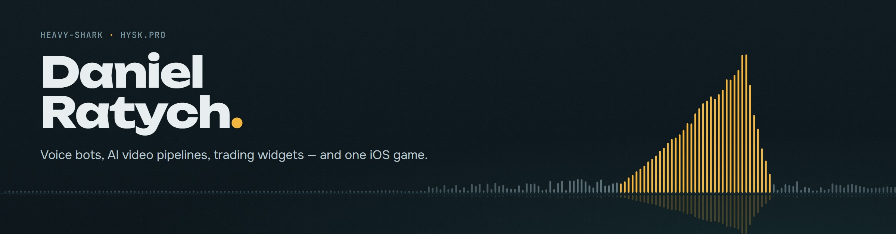
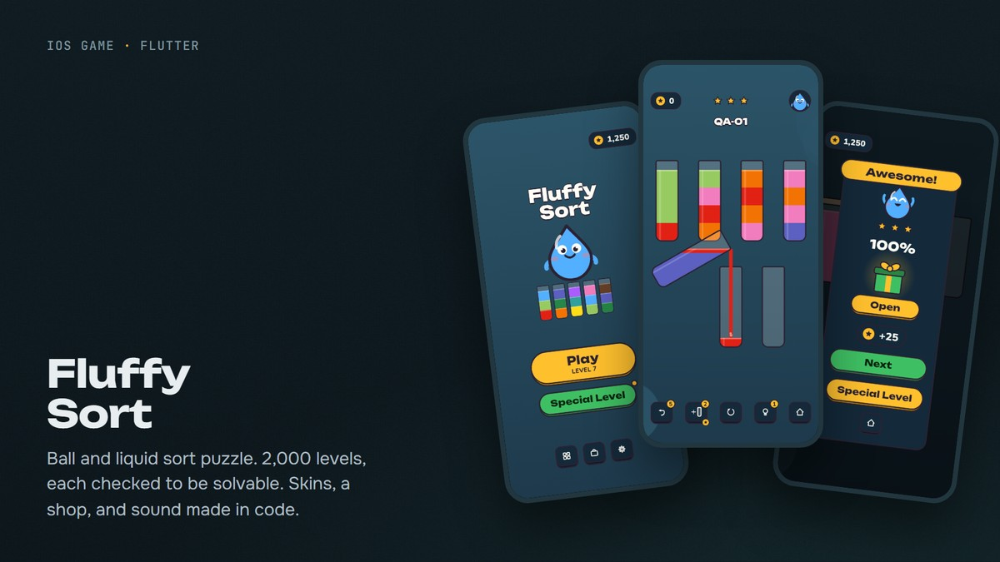
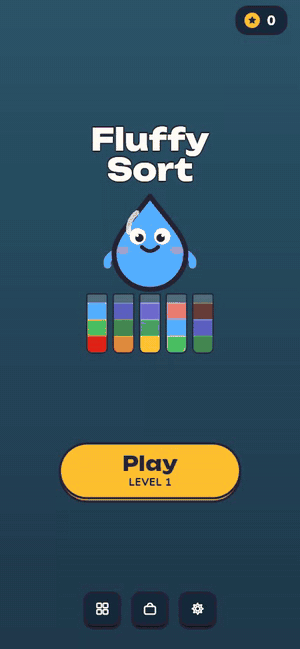

I build things that listen, watch and count: voice bots on Gemini and ElevenLabs, AI pipelines that cut and caption video, small trading tools, and a puzzle game for iPhone. Mostly Python; TypeScript when it needs a face.

### Stack

### Projects

<table>
  <tr>
    <td width="50%" valign="top">
      
       <b><a href="https://hysk.pro/fsp">Fluffy Sort</a></b> · Flutter, Riverpod
       Ball and liquid sort puzzle for iPhone. 2,000 levels, each checked by a built-in solver.
    </td>
    <td width="50%" valign="top">
      
       <b><a href="https://github.com/heavy-shark/widget_binance">widget_binance</a></b> · Python, Übersicht
       Binance USDⓈ-M futures PnL, ROE and liquidation distance on the macOS desktop.
    </td>
  </tr>
  <tr>
    <td width="50%" valign="top">
      
       <b><a href="https://github.com/heavy-shark/discord-voice-companion">discord-voice-companion</a></b> · Python, Gemini, ElevenLabs
       A voice-channel regular: transcribes every speaker and replies out loud in uk, ru or en.
    </td>
    <td width="50%" valign="top">
      
       <b><a href="https://github.com/heavy-shark/tg-voice-transcriber">tg-voice-transcriber</a></b> · Python, aiogram, Gemini
       Voice messages and video notes in, summary, what's in frame and full transcript out.
    </td>
  </tr>
</table>

### Fluffy Sort, recorded

<table>
  <tr>
    <td width="250"></td>
    <td valign="top">
      Level 1, solved in the optimal five pours.
        
      Levels are generated and verified offline by an A* solver in a pure-Dart core package. On top of it: liquid and ball modes, hidden and frozen tubes, seven themes, a shop, and sound effects synthesized in code.
        
      1,100+ automated tests, including golden screenshots of every screen.
    </td>
  </tr>
</table>

### Activity

<picture>
  <source media="(prefers-color-scheme: dark)" srcset="https://raw.githubusercontent.com/heavy-shark/heavy-shark/output/snake-dark.svg">
  
</picture>
